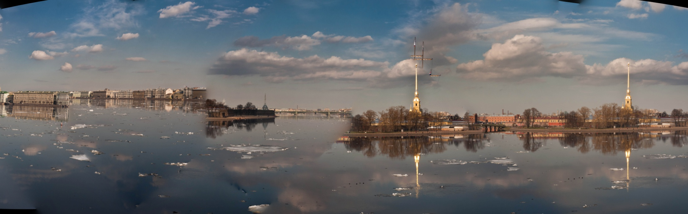
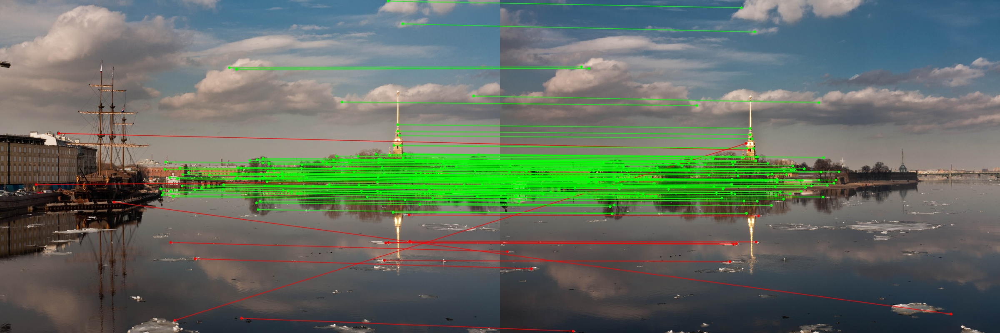
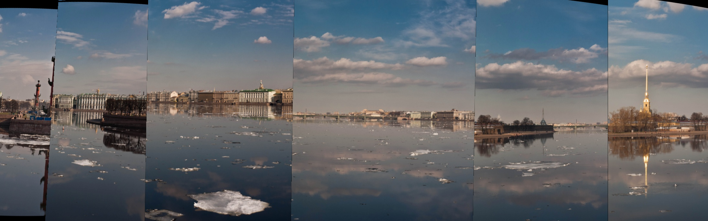

# Panorama Stitching

[](https://colab.research.google.com/github/darine-mohamed/panorama-stitching/blob/main/panorama_CV.ipynb)

An end-to-end image stitching pipeline in Python. It takes a set of overlapping photos (in any order) and produces a single seamless panorama. The matching, homography estimation, RANSAC, warping, exposure compensation, blending and cropping stages are implemented from scratch with NumPy; OpenCV is used only for SIFT feature extraction and low-level image primitives (pixel sampling, Gaussian pyramids, distance transform).



*Six photos stitched automatically into one panorama (multi-band blending, cropped).*

## Pipeline

| Stage | What it does |
|---|---|
| Features | SIFT keypoints and 128-d descriptors (OpenCV) |
| Matching | Brute-force L2 matching, Lowe ratio test (0.75), mutual nearest-neighbour check |
| Homography | Direct Linear Transform with Hartley normalisation |
| Outlier rejection | Adaptive RANSAC using symmetric transfer error, refit on inliers |
| Image ordering | Match graph over all pairs, maximum spanning tree on inlier counts. Works with unordered photos and drops images that do not overlap |
| Projection | Focal length estimated from the homographies, images warped onto a cylinder to avoid stretching on wide scenes |
| Warping | Inverse warping with bilinear sampling into a common canvas |
| Exposure | Least-squares gain compensation across overlaps |
| Blending | Feathering and multi-band (Laplacian pyramid) blending |
| Cropping | Largest axis-aligned rectangle with no empty pixels |

## Results

| Matches (green: RANSAC inliers, red: rejected) | No blending | Multi-band blending |
|---|---|---|
|  |  |  |

## Run

```bash
pip install -r requirements.txt
python run.py data/boat output/boat                  # multi-band blend (default)
python run.py data/boat output/boat --blend feather  # or: overwrite
python run.py data/my_photos output/mine             # your own photos
python run.py data/x output/x --planar               # planar instead of cylindrical (narrow field of view)
```

Or open the notebook in Colab with the badge above.

## Notes and limitations

- Photos should be taken from one spot by rotating the camera, with roughly 30-50% overlap. Moving the camera causes parallax and ghosting.
- Moving objects (water, people) blur slightly at seams. There is no bundle adjustment or graph-cut seam finding.
- Flat scenes with repeated patterns (for example a folded map) produce false matches.

## Data

`data/boat` and `data/set_a` are public stitching test images from the [opencv_extra](https://github.com/opencv/opencv_extra) repository.
